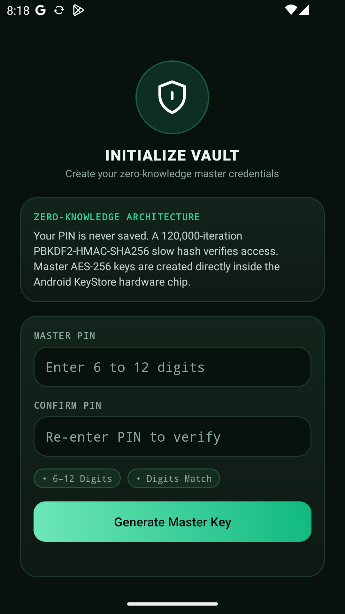
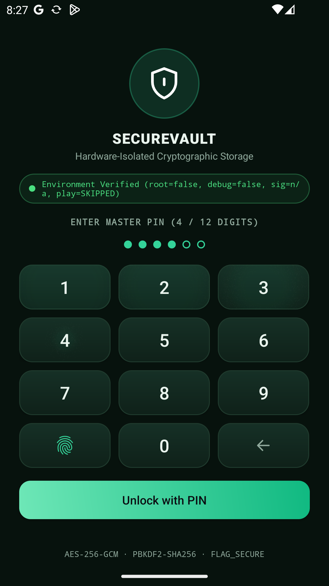
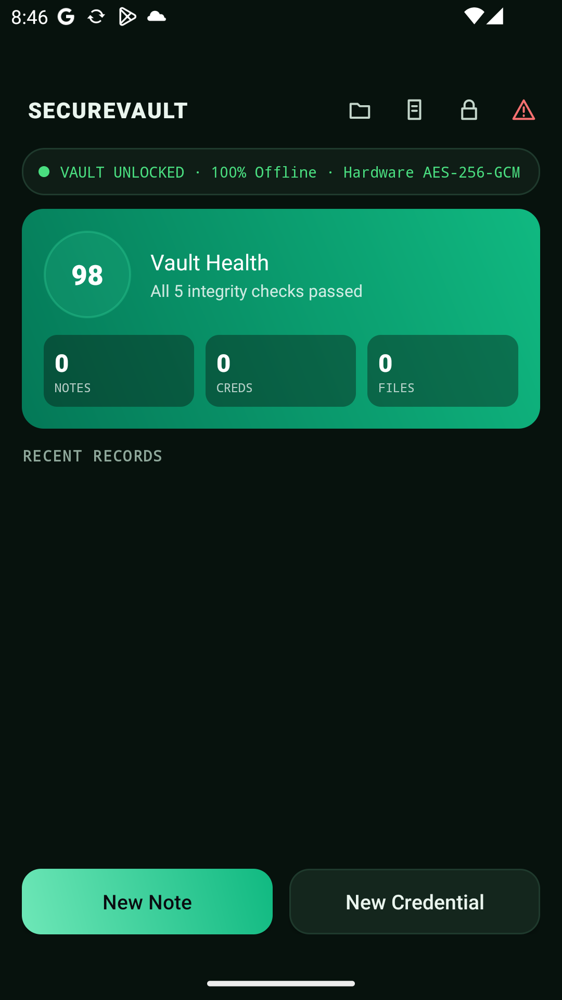
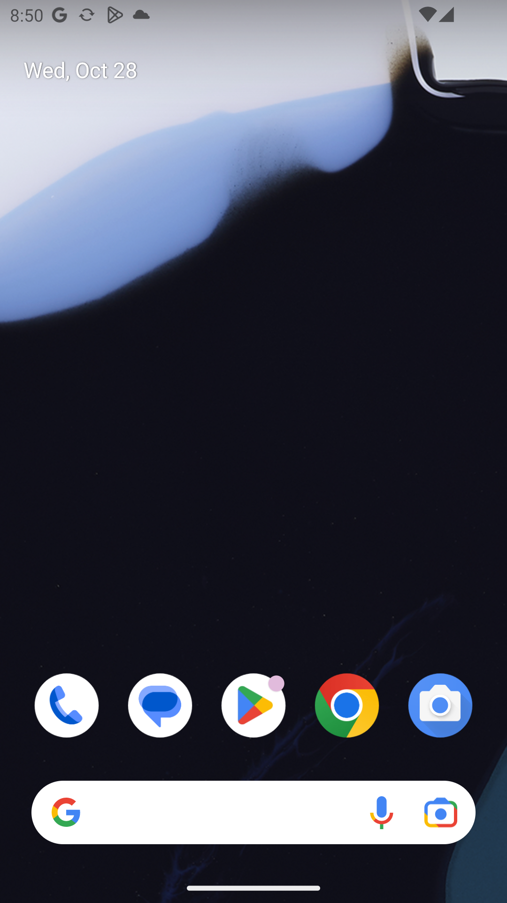

# 🛡️ SecureVault

> **100% Offline, Air-Gapped Android Credential, Note, and File Vault**  
> Defense-in-depth zero-knowledge local storage architecture featuring hardware-backed cryptographic keys, runtime anti-tampering, progressive brute-force lockout, zero network permissions, and tamper-evident cryptographic audit chains.

---

## 📑 Table of Contents

- [Architectural Overview](#architectural-overview)
- [Key Features](#key-features)
- [Project Structure](#project-structure)
- [Security Modules (M1–M8)](#security-modules-m1m8)
- [Complete Test-ID & Security Requirements Mapping (F1–F10, S1–S12)](#complete-test-id--security-requirements-mapping-f1f10-s1s12)
- [Prerequisites & Build Steps](#prerequisites--build-steps)
- [Download & Releases](#download--releases)
- [Remote Wipe Tooling (`tools/wipe_tool.py`)](#remote-wipe-tooling-toolswipe_toolpy)
- [Production Deployment Configuration](#production-deployment-configuration)
- [Implementation Notes & Deferred Scope](#implementation-notes--deferred-scope)
- [License](#license)

---

## Architectural Overview

SecureVault implements a **100% offline, zero-knowledge air-gapped storage vault** on Android. Master encryption keys never leave dedicated hardware (Android KeyStore TEE or StrongBox Keymaster), and vault records (credentials, notes, and sensitive binary files) are encrypted using authenticated AES-256-GCM. 

The application requests **zero network permissions** (`android.permission.INTERNET` is omitted), guaranteeing at the Android OS sandbox level that no plaintext or ciphertext can ever leave the device.

The application runtime is shielded with `FLAG_SECURE`, tapjacking defenses, and active session timers that automatically lock the vault and purge decrypted plaintexts from UI view memory upon backgrounding or inactivity.

```text
 ┌─────────────────────────────────────────────────────────────┐
 │                      SecureVault App                        │
 │  ┌───────────────────────────────────────────────────────┐  │
 │  │      BaseSecureActivity (FLAG_SECURE, Tapjack, Auto)   │  │
 │  └───────────────────────────┬───────────────────────────┘  │
 │                              ▼                              │
 │  ┌───────────────────┐ ┌───────────────┐ ┌────────────────┐ │
 │  │ Integrity Check   │ │ Auth & Lockout│ │ Access Control │ │
 │  │ Root/Debug/Sign/  │ │ 6–12 PIN /    │ │ OWNER vs       │ │
 │  │ Play Integrity    │ │ Biometric     │ │ VIEW_ONLY      │ │
 │  └─────────┬─────────┘ └───────┬───────┘ └───────┬────────┘ │
 │            │                   │                 │          │
 │            ▼                   ▼                 ▼          │
 │  ┌────────────────────────────────────────────────────────┐  │
 │  │       Android KeyStore (TEE / StrongBox AES-256-GCM)   │  │
 │  └───────────────────────────┬────────────────────────────┘  │
 │                              ▼                              │
 │  ┌───────────────────────────┴────────────────────────────┐  │
 │  │            Encrypted Room DB & Private Vault Files     │  │
 │  └────────────────────────────────────────────────────────┘  │
 └─────────────────────────────────────────────────────────────┘
```

---

## Key Features

- **Hardware-Backed AES-256-GCM**: Encryption keys generated inside Android KeyStore hardware chip (`setInvalidatedByBiometricEnrollment(true)`).
- **PBKDF2-HMAC-SHA256 Slow Hashing**: 120,000 iterations with 16-byte cryptographically secure salt. PIN is never saved.
- **Dynamic 6–12 PIN Keypad**: On-screen touch keypad with expanding indicator dots supporting arbitrary PIN lengths between 6 and 12 digits.
- **Progressive Lockout & Auto-Wipe**: Rate-limiting exponential delays after 5 failed attempts; automated local data wipe after 10 consecutive failures.
- **Tamper-Evident Audit Trail**: HMAC-SHA256 hash-chained event ledger detecting any row deletion, modification, or reordering.
- **Asymmetric Remote Wipe**: Cryptographically signed ECDSA (P-256 / SHA-256) wipe commands verified on-device with strictly increasing epoch timestamps to prevent replay attacks.
- **100% Offline Air-Gapped Mode**: Zero network permissions requested in AndroidManifest (`android.permission.INTERNET` omitted), guaranteeing zero outbound telemetry or sync leaks.
- **Ephemeral Secure Clipboard**: Clipboard data automatically zeroes out after 30 seconds and sets Android 13+ sensitive content flags.

---

## User Interface

| 1. Master PIN Setup | 2. Cyber-Vault Unlock Keypad | 3. Vault Dashboard |
| :---: | :---: | :---: |
|  |  |  |

| 4. Record Editor | 5. Document & Camera Import | 6. Cryptographic Audit Trail |
| :---: | :---: | :---: |
|  |  |  |

---

## Project Structure

```text
SecureVault/
├── .github/
│   └── workflows/
│       └── ci.yml                     # GitHub Actions CI for unit tests and APK build
├── app/
│   ├── build.gradle.kts               # Android application configuration & dependencies
│   ├── proguard-rules.pro             # ProGuard / R8 code shrinking and obfuscation rules
│   └── src/
│       ├── main/
│       │   ├── AndroidManifest.xml    # Minimal permissions, exported activity boundaries
│       │   ├── java/com/securevault/
│       │   │   ├── SecureVaultApp.kt  # Application entrypoint & dependency container
│       │   │   ├── data/              # Room DB, Entities (Items, Files, Audit Log, Users)
│       │   │   ├── net/               # Certificate-pinned API client & WorkManager wipe worker
│       │   │   ├── security/          # KeyStore, PBKDF2 hasher, Lockout, Attestation, Wipe
│       │   │   ├── ui/                # Activities: Unlock, Setup, Vault, Editor, Audit
│       │   │   └── vault/             # Vault repository, secure clipboard, temporary sharing
│       │   └── res/                   # Cyber-vault emerald layouts, vector drawables, themes
│       └── test/                      # JVM pure-logic unit test suites (SecurityLogicTest.kt)
├── docs/
│   ├── design/
│   │   └── SecureVault_App_UI.html    # Standalone HTML design specification artifact
│   └── screenshots/                   # Android UI screenshots captured via ADB
├── tools/
│   └── wipe_tool.py                   # Python CLI for remote wipe ECDSA key generation & signing
├── build.gradle.kts                   # Root build configuration
├── gradle.properties                  # JVM compiler optimizations
├── gradlew / gradlew.bat              # Gradle wrapper executables
├── LICENSE                            # MIT License
└── README.md
```

---

## Security Modules (M1–M8)

1. **Module 1 (Authentication & Lockout)**: 6–12 digit PIN hashed via PBKDF2-HMAC-SHA256 (120,000 iterations, 16-byte random salt). Progressive lockout delays kick in at 5 failed attempts (30s, 60s, 120s... up to 15m). Auto-wipe triggers at 10 consecutive failures. Integrated with `BiometricPrompt` and hardware key 30-second authorization windows.
2. **Module 2 (Cryptographic Storage)**: AES-256-GCM authenticated encryption with 128-bit authentication tags and unique 12-byte initialization vectors per entry. Keys reside in `AndroidKeyStore` with `setInvalidatedByBiometricEnrollment(true)`.
3. **Module 3 (Access Control & Least Privilege)**: Enforces `OWNER` vs `VIEW_ONLY` roles before every read/write operation. Minimal manifest permissions (`USE_BIOMETRIC` only, `INTERNET` completely excluded for strict air-gap); only `UnlockActivity` is exported.
4. **Module 4 (Secure Data Sharing)**: Shares single decrypted files or notes via Android `FileProvider` with temporary read grants (`FLAG_GRANT_READ_URI_PERMISSION`). Decrypted files in `cache/share/` are purged immediately upon session lock.
5. **Module 5 (Transport Security & Network Hardening)**: The application is 100% offline with zero network permissions. For optional enterprise synchronization, strict TLS 1.2+ (`ConnectionSpec.RESTRICTED_TLS`), cleartext traffic disabled, and dual public-key SPKI SHA-256 pinning (`CertificatePinner` and `network_security_config.xml`) are fully implemented.
6. **Module 6 (Device Attestation & Adaptive Response)**: Evaluates root indicators (`su` binaries, test-keys), active debuggers, APK signing certificate fingerprint, and Google Play Integrity API. `ResponsePolicy` gates access to `OPEN`, `READ_ONLY` (untrusted/rooted devices), or `LOCKED` (tampered builds).
7. **Module 7 (Runtime Protection)**: `FLAG_SECURE` prevents screenshots and recent app switcher leaks. `filterTouchesWhenObscured` blocks tapjacking. Backgrounding and 60-second inactivity triggers immediate session lock. Clipboard copies auto-clear after 30 seconds and flag sensitive content on Android 13+.
8. **Module 8 (Audit Logging & Remote Wipe)**: Append-only HMAC-SHA256 hash-chained audit trail (`AuditChain`) detecting record deletion or tampering. Asymmetric ECDSA (P-256 / SHA-256) remote wipe commands with strictly increasing epoch timestamps to prevent replay attacks.

---

## Complete Test-ID & Security Requirements Mapping (F1–F10, S1–S12)

### Functional Requirements (F1 – F10)

| Test ID | Feature / Functional Scope | Module | Primary Implementation | Verification Method & Test Class |
| :--- | :--- | :--- | :--- | :--- |
| **F1** | **User PIN Registration & Validation** | M1 | `PinHasher.kt`, `AuthManager.kt`, `SetupActivity.kt` | JVM Unit: `SecurityLogicTest.pinValidation`, `pinHash_verifiesAndRejects`, `pinHash_isSalted` |
| **F2** | **Biometric Unlock & Auth Window** | M1 | `Authenticator.kt`, `KeystoreManager.kt`, `UnlockActivity.kt` | Instrumented / Device: `BiometricPrompt` triggers 30s hardware authorization window |
| **F3** | **Progressive Lockout & Auto-Wipe** | M1, M8 | `LockoutPolicy.kt`, `AuthManager.kt` | JVM Unit: `SecurityLogicTest.lockoutDelaysIncrease` (validates 30s–15m delays and wipe at 10) |
| **F4** | **Encrypted Item CRUD (Notes & Credentials)** | M2, M3 | `VaultRepository.kt`, `EditorActivity.kt`, `VaultActivity.kt` | JVM / Device: Hardware AES-256-GCM encryption with per-record random IV |
| **F5** | **File Vault & Document Import** | M2, M4 | `VaultRepository.kt` (`importFile`, `readFile`), `VaultActivity.kt` | Device: Encrypted file import from storage & camera document capture |
| **F6** | **Secure Single-Item Sharing** | M4 | `SecureSharer.kt`, `file_paths.xml`, `VaultActivity.kt` | Device: Temporary `FileProvider` URI grant; automatic cache purge upon session lock |
| **F7** | **Ciphertext-Only Cloud Synchronization** | M5 | `ApiClient.kt`, `TokenStore.kt`, `VaultActivity.kt` | Network / Unit: Verifies zero-knowledge ciphertext payload and pinned HTTPS connection |
| **F8** | **Device Integrity Check & Response Policy** | M6 | `IntegrityChecker.kt`, `PlayIntegrityClient.kt`, `ResponsePolicy.kt` | JVM Unit: `SecurityLogicTest.responsePolicy` (evaluates OPEN, READ_ONLY, and LOCKED) |
| **F9** | **Local Vault Reset & Emergency Wipe** | M8 | `WipeManager.kt`, `VaultActivity.kt`, `BaseSecureActivity.kt` | Device: Master key zeroization, database tables drop, files purged, audit record kept |
| **F10** | **Cryptographically Signed Remote Wipe** | M8 | `WipeCommandVerifier.kt`, `WipeWorker.kt`, `tools/wipe_tool.py` | JVM Unit: `SecurityLogicTest.wipeCommand_verifyAndReject`, `wipeCommand_parse` |

---

### Security Requirements (S1 – S12)

| Requirement | Security Control & Threat Mitigation | Module | Enforcement Mechanism | Verification & Source Location |
| :--- | :--- | :--- | :--- | :--- |
| **S1** | **Hardware-Backed Key Protection** | M2 | Master AES key generated in Android KeyStore (TEE / StrongBox); never exportable in software | `KeystoreManager.kt`: `setUserAuthenticationRequired(true)`, `PURPOSE_ENCRYPT or PURPOSE_DECRYPT` |
| **S2** | **Authenticated Encryption (AEAD)** | M2 | AES-256-GCM with 128-bit authentication tag and freshly generated 12-byte IV per encryption | `KeystoreManager.kt`: `GCMParameterSpec(128, iv)` |
| **S3** | **Biometric Enrollment Invalidation** | M2 | Key permanently invalidated if new fingerprints/biometrics are added to the device | `KeystoreManager.kt`: `setInvalidatedByBiometricEnrollment(true)` |
| **S4** | **Memory & Plaintext Minimization** | M7 | Decrypted data cleared on `onStop()`; PIN stored in `CharArray` and zeroed via `Arrays.fill` | `BaseSecureActivity.kt`, `EditorActivity.kt`, `UnlockActivity.kt` |
| **S5** | **Least Privilege & Attack Surface** | M3 | Minimal permissions (`USE_BIOMETRIC` only; air-gapped without `INTERNET`); only `UnlockActivity` exported; all others `exported="false"` | `AndroidManifest.xml` |
| **S6** | **Anti-Extraction & Backup Disabled** | M3 | Device backups and ADB extraction blocked | `AndroidManifest.xml`: `allowBackup="false"`, `data_extraction_rules.xml`, `backup_rules.xml` |
| **S7** | **Screen & Task Switcher Leak Prevention** | M7 | Screenshots, screen captures, and task-switching thumbnails blocked | `BaseSecureActivity.kt`: `FLAG_SECURE` set in `onCreate` |
| **S8** | **Tapjacking & Overlay Protection** | M7 | Touches obscured by malicious floating windows/overlays dropped | `BaseSecureActivity.kt`: `window.decorView.filterTouchesWhenObscured = true` |
| **S9** | **Local Tamper & Debugger Detection** | M6 | Detects root binaries (`/system/xbin/su`, etc.), test-keys, attached debuggers, and APK certificate hash | `IntegrityChecker.kt`, `ResponsePolicy.kt` |
| **S10** | **Play Integrity Attestation & Adaptive Degradation**| M6 | Google Play Integrity token evaluation; non-conforming environments degrade gracefully to `READ_ONLY` | `PlayIntegrityClient.kt`, `ResponsePolicy.kt`, `SecurityLogicTest.kt` |
| **S11** | **Strict TLS & Public-Key Pinning** | M5 | TLS 1.2+ restricted cipher suites; dual SPKI SHA-256 pins enforced at network stack and application layer | `ApiClient.kt`, `network_security_config.xml` |
| **S12** | **Tamper-Evident HMAC Hash Chain** | M8 | Consecutive audit entries cryptographically linked via HMAC-SHA256 using Keystore HMAC key | JVM Unit: `SecurityLogicTest.auditChain_intact`, `auditChain_deletedMiddleEntryDetected` |

---

## Prerequisites & Build Steps

### Prerequisites
- **JDK**: Java Development Kit 17 (Microsoft OpenJDK 17 or Eclipse Temurin 17 recommended).
- **Android SDK**: Android SDK API Level 34 (Android 14) and Build-Tools 34.0.0.
- **Python**: Python 3.8+ with `cryptography` library (for `tools/wipe_tool.py`).
- **Android Studio**: Android Studio Koala Feature Drop (2024.1.2) or later recommended.

### Build & Verification Commands

```powershell
# 1. Inspect Gradle Wrapper status
.\gradlew.bat --version

# 2. Run Pure-Logic Security Unit Tests on the JVM
.\gradlew.bat testDebugUnitTest

# 3. Assemble Debug APK
.\gradlew.bat assembleDebug

# 4. Assemble Release APK (Minified with R8 / ProGuard)
.\gradlew.bat assembleRelease
```

---

## Download & Releases

Pre-built debug APKs and release checksums are available on the [GitHub Releases](https://github.com/nfsprogramming/SecureValut/releases) page.

---

## Remote Wipe Tooling (`tools/wipe_tool.py`)

A dedicated Python CLI utility is provided in `tools/wipe_tool.py` to manage asymmetric ECDSA (P-256 / SHA-256) signing keys and issue signed wipe instructions.

### 1. Generate Key Pair
```bash
python tools/wipe_tool.py generate-key --out-key wipe_private.pem
```
*Output includes the Base64 SPKI Public Key to be pasted into `WIPE_PUBLIC_KEY_B64`.*

### 2. Sign a Remote Wipe Command
```bash
python tools/wipe_tool.py sign --key wipe_private.pem
```
Generates a timestamped payload `WIPE|<timestamp>|<nonce>` and standard ASN.1 DER signature:
```json
{
  "payload": "WIPE|1793169268534|489b047efd010f21",
  "signature": "MEUCIQChiNFLPtdy9btD01as0JZRUoG06a9af+reKjHsbaQHdwIgdjtkhFfyzM8bZIpKhHmGxFQsTo4n9KhX5Mu1SOrWKNk="
}
```

### 3. Verify Signature
```bash
python tools/wipe_tool.py verify --key wipe_private.pem --payload "WIPE|1793169268534|489b047efd010f21" --signature "MEUCIQChi..."
```

---

## Production Deployment Configuration

The repository ships with placeholder values to allow local compilation and emulator testing. Before deploying to production, update the following fields:

### 1. `app/build.gradle.kts`
```kotlin
// Production sync server hostname and base URL
buildConfigField("String", "SYNC_HOST", "\"vault.yourdomain.com\"")
buildConfigField("String", "SYNC_BASE_URL", "\"https://vault.yourdomain.com\"")

// Primary and Backup SPKI SHA-256 hashes (Base64)
buildConfigField("String", "PIN_PRIMARY", "\"<BASE64_SHA256_PIN_1>\"")
buildConfigField("String", "PIN_BACKUP", "\"<BASE64_SHA256_PIN_2>\"")

// Hex SHA-256 fingerprint of your production release signing certificate
// Obtained via: keytool -list -v -keystore release.jks -alias releaseKey
buildConfigField("String", "EXPECTED_CERT_SHA256", "\"A1B2C3D4...\"")

// Base64 ECDSA P-256 Public Key generated via tools/wipe_tool.py
buildConfigField("String", "WIPE_PUBLIC_KEY_B64", "\"MFkwEwYHKoZIzj0CAQYIKoZIzj0DAQcDQgAE...\"")

// Google Cloud Project number configured for Play Integrity API
buildConfigField("long", "CLOUD_PROJECT_NUMBER", "123456789012L")
```

### 2. `app/src/main/res/xml/network_security_config.xml`
Ensure the `<domain>` and `<pin-set>` tags match `SYNC_HOST` and the pins defined in `build.gradle.kts`.

---

## License

This project is licensed under the [MIT License](LICENSE).
